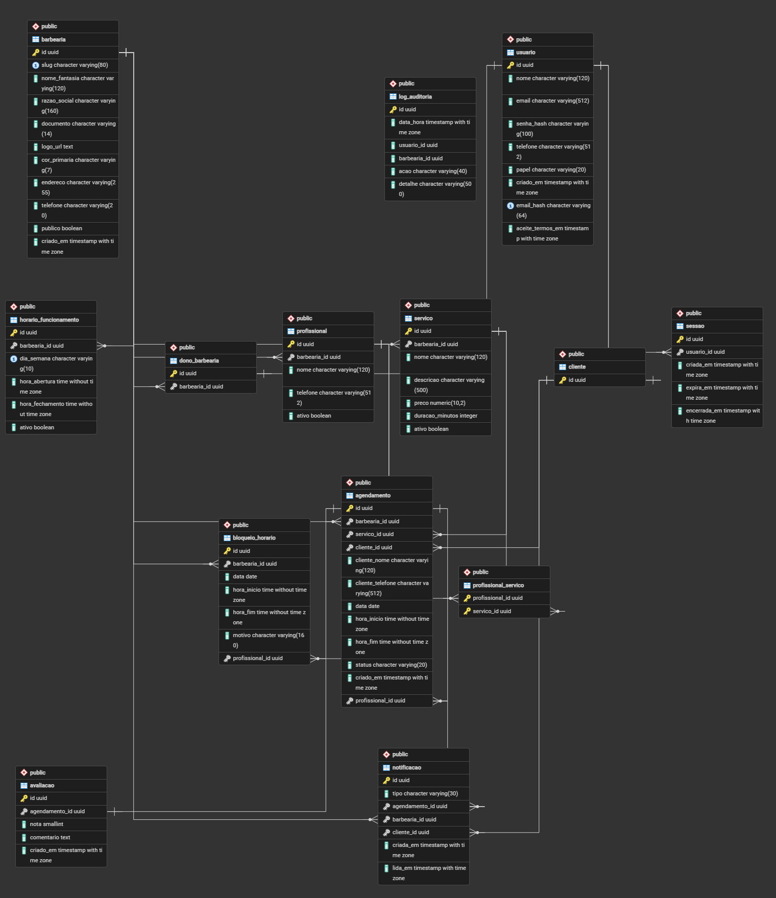

# Dicionário de dados - Cadeira Livre

Banco **PostgreSQL 16**. A estrutura é criada e versionada pelo **Flyway**, com as migrations em
`backend/src/main/resources/db/migration` (V1 a V12). Elas são a fonte oficial do schema: este documento
só explica o que cada tabela guarda.

## Como o banco separa as barbearias (multi-tenant)

- Cada barbearia é um **tenant**. As tabelas do painel (`servico`, `profissional`, `horario_funcionamento`,
  `bloqueio_horario`, `agendamento`) têm a coluna **`barbearia_id`**.
- O `barbearia_id` vem sempre do token (JWT) do dono, nunca do que chega na requisição. Por isso uma
  barbearia não enxerga os dados de outra (RNF04 e RNF05).
- Todas as chaves primárias são **UUID**, para os ids não serem sequenciais nem fáceis de adivinhar.

## Dados criptografados (RNF03)

| Coluna | Como é guardada |
|---|---|
| `usuario.email` | Criptografado com AES-GCM |
| `usuario.telefone` | Criptografado com AES-GCM |
| `usuario.email_hash` | HMAC-SHA256 do e-mail, usado no login e na regra de e-mail único (RF03) |
| `usuario.senha_hash` | Hash BCrypt, nunca a senha |
| `agendamento.cliente_telefone` | Criptografado com AES-GCM |
| `profissional.telefone` | Criptografado com AES-GCM |

O texto criptografado muda a cada gravação, por isso as colunas criptografadas têm até 512 caracteres
e a busca por e-mail usa o `email_hash`.

## Tabelas

### barbearia
A barbearia (tenant) e o portal dela (RF06 a RF09).

| Coluna | Tipo | Descrição |
|---|---|---|
| id | uuid | Chave primária |
| slug | varchar(80) | Endereço do portal (`/saloes/{slug}`), único |
| nome_fantasia | varchar(120) | Nome mostrado no portal (RF08) |
| razao_social | varchar(160) | Nome da empresa |
| documento | varchar(14) | CPF ou CNPJ, só números |
| logo_url | text | Logo em base64, até 1 MB (RF06) |
| cor_primaria | varchar(7) | Cor do portal em `#RRGGBB` (RF07) |
| endereco | varchar(255) | Endereço, usado no mapa |
| telefone | varchar(20) | Telefone de contato do portal |
| publico | boolean | Se o portal está publicado |
| criado_em | timestamptz | Data do cadastro |

### usuario
Dados comuns a cliente e dono. Usa **herança**: `cliente` e `dono_barbearia` têm o mesmo `id` do `usuario`.

| Coluna | Tipo | Descrição |
|---|---|---|
| id | uuid | Chave primária |
| nome | varchar(120) | Nome |
| email | varchar(512) | E-mail criptografado |
| email_hash | varchar(64) | Hash do e-mail, único |
| senha_hash | varchar(100) | Hash BCrypt da senha |
| telefone | varchar(512) | Telefone criptografado |
| papel | varchar(20) | `CLIENTE` ou `DONO` |
| aceite_termos_em | timestamptz | Quando aceitou os termos e a política de privacidade (RNF02) |
| criado_em | timestamptz | Data do cadastro |

### cliente
Cliente que agenda horários (RF01). Só tem o `id`, que aponta para `usuario`. Se a conta for excluída
(LGPD), a linha é apagada e os agendamentos dele ficam anônimos.

### dono_barbearia
Dono da barbearia (RF02). Tem o `id` (aponta para `usuario`) e o `barbearia_id` da barbearia dele.

### servico
Catálogo de serviços (RF010 e RF12).

| Coluna | Tipo | Descrição |
|---|---|---|
| id | uuid | Chave primária |
| barbearia_id | uuid | Barbearia dona do serviço |
| nome | varchar(120) | Ex.: Corte, Barba |
| descricao | varchar(500) | Descrição opcional |
| preco | numeric(10,2) | Preço |
| duracao_minutos | integer | Duração do serviço |
| ativo | boolean | `false` = excluído sem perder o histórico (exclusão lógica) |

### profissional
Barbeiros da barbearia.

| Coluna | Tipo | Descrição |
|---|---|---|
| id | uuid | Chave primária |
| barbearia_id | uuid | Barbearia do profissional |
| nome | varchar(120) | Nome |
| telefone | varchar(512) | Telefone criptografado |
| ativo | boolean | `false` = desativado |

### profissional_servico
Quais serviços cada profissional faz (muitos para muitos). Chave primária: `profissional_id` + `servico_id`.

### horario_funcionamento
Horário de funcionamento por dia da semana (RF19). Um registro por dia em cada barbearia.

| Coluna | Tipo | Descrição |
|---|---|---|
| id | uuid | Chave primária |
| barbearia_id | uuid | Barbearia |
| dia_semana | varchar(10) | `MONDAY` a `SUNDAY` |
| hora_abertura | time | Abre às |
| hora_fechamento | time | Fecha às |
| ativo | boolean | `false` = fechado nesse dia |

### bloqueio_horario
Datas e horários bloqueados: feriado, manutenção ou folga de um profissional (RF20).

| Coluna | Tipo | Descrição |
|---|---|---|
| id | uuid | Chave primária |
| barbearia_id | uuid | Barbearia |
| profissional_id | uuid | Vazio = vale para a barbearia toda; preenchido = folga do profissional |
| data | date | Dia bloqueado |
| hora_inicio / hora_fim | time | Vazios = dia inteiro; preenchidos = só esse intervalo |
| motivo | varchar(160) | Motivo opcional |

### agendamento
Pedidos de horário feitos pelo cliente (RF14, RF15 e RF21).

| Coluna | Tipo | Descrição |
|---|---|---|
| id | uuid | Chave primária |
| barbearia_id | uuid | Barbearia |
| servico_id | uuid | Serviço escolhido |
| profissional_id | uuid | Profissional escolhido |
| cliente_id | uuid | Cliente com conta (vazio se ele excluiu a conta) |
| cliente_nome | varchar(120) | Nome informado no pedido |
| cliente_telefone | varchar(512) | Telefone criptografado |
| data | date | Dia do atendimento |
| hora_inicio / hora_fim | time | Horário do atendimento |
| status | varchar(20) | `PENDENTE`, `APROVADO`, `RECUSADO`, `CANCELADO` ou `CONCLUIDO` |
| criado_em | timestamptz | Data do pedido |

Todo pedido nasce `PENDENTE` (RF15). Na aprovação, o sistema confere que o profissional não tem outro
agendamento aprovado no mesmo horário (RF21).

### avaliacao
Nota que o cliente dá depois do atendimento concluído. Uma por agendamento.

| Coluna | Tipo | Descrição |
|---|---|---|
| id | uuid | Chave primária |
| agendamento_id | uuid | Agendamento avaliado, único |
| nota | smallint | De 1 a 5 |
| comentario | text | Comentário opcional |
| criado_em | timestamptz | Data da avaliação |

### notificacao
Avisos dentro do sistema para o dono e para o cliente, incluindo os lembretes automáticos (RF03 e RF04
dos requisitos de alto nível).

| Coluna | Tipo | Descrição |
|---|---|---|
| id | uuid | Chave primária |
| tipo | varchar(30) | `NOVO_AGENDAMENTO`, `CANCELAMENTO`, `HORARIO_APROVADO`, `HORARIO_RECUSADO`, `ATENDIMENTO_CONCLUIDO`, `LEMBRETE_DONO`, `LEMBRETE_CLIENTE` |
| agendamento_id | uuid | Agendamento da notificação |
| barbearia_id | uuid | Preenchido quando o aviso é para o dono |
| cliente_id | uuid | Preenchido quando o aviso é para o cliente |
| criada_em | timestamptz | Quando foi enviada |
| lida_em | timestamptz | Quando foi aberta (vazio = não lida) |

A notificação é para o dono **ou** para o cliente, nunca os dois (regra no banco). O texto não fica
guardado: é montado na hora de mostrar, para não guardar dados pessoais (LGPD). Cada lembrete é criado
uma vez só por agendamento (índice único).

### sessao
Sessões de login (RF04 e RF05). O token leva o id da sessão.

| Coluna | Tipo | Descrição |
|---|---|---|
| id | uuid | Chave primária, vai dentro do token |
| usuario_id | uuid | Usuário que fez login |
| criada_em | timestamptz | Hora do login |
| expira_em | timestamptz | Vence junto com o token (24 horas) |
| encerrada_em | timestamptz | Hora do logout (vazio = sessão aberta) |

Todo dia às 3h as sessões vencidas são apagadas.

### log_auditoria
Registro das ações críticas com data/hora e usuário (RNF09). Não tem chave estrangeira de propósito:
o registro continua existindo mesmo se o usuário ou a barbearia forem excluídos.

| Coluna | Tipo | Descrição |
|---|---|---|
| id | uuid | Chave primária |
| data_hora | timestamptz | Quando aconteceu |
| usuario_id | uuid | Quem fez |
| barbearia_id | uuid | Em qual barbearia |
| acao | varchar(40) | `PORTAL_ALTERADO`, `PORTAL_PUBLICADO`, `PORTAL_OCULTADO`, `AGENDAMENTO_APROVADO`, `AGENDAMENTO_RECUSADO`, `AGENDAMENTO_CONCLUIDO` |
| detalhe | varchar(500) | Texto curto sobre a ação |

## Migrations (Flyway)

| Versão | O que fez |
|---|---|
| V1 | Schema inicial: barbearia, usuario, cliente, dono_barbearia, servico, horario_funcionamento, bloqueio_horario, agendamento e avaliacao |
| V2 | E-mail e telefone criptografados, coluna `email_hash` (e-mail único) e data do aceite dos termos |
| V3 | Tabela `log_auditoria` |
| V4 | Tabelas `profissional` e `profissional_servico` |
| V5 | Folga de profissional no `bloqueio_horario` e regra das horas do bloqueio |
| V6 | Coluna `profissional_id` no agendamento |
| V7 | Profissional passa a ser obrigatório no agendamento |
| V8 | Telefone do agendamento criptografado |
| V9 | Índice para o histórico do cliente |
| V10 | Tabela `notificacao` |
| V11 | Lembrete criado uma vez só por agendamento |
| V12 | Tabela `sessao` (logout) |

A tabela `flyway_schema_history` é criada pelo próprio Flyway e guarda quais migrations já rodaram.
